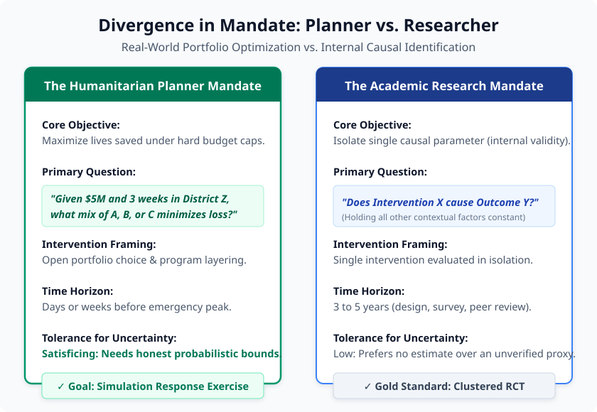
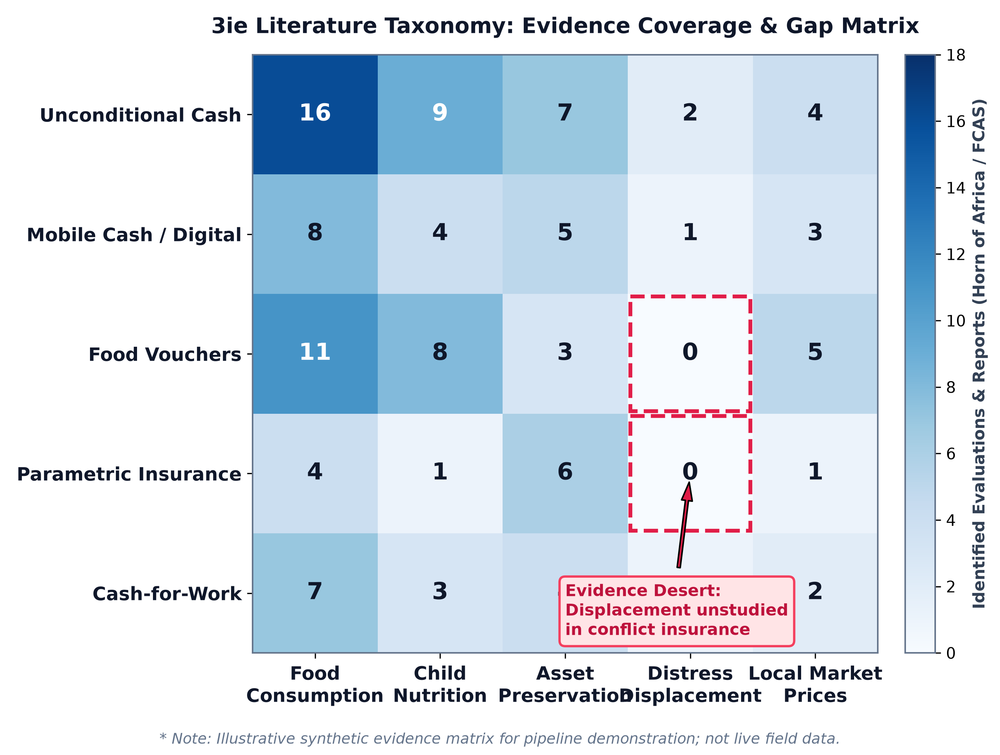
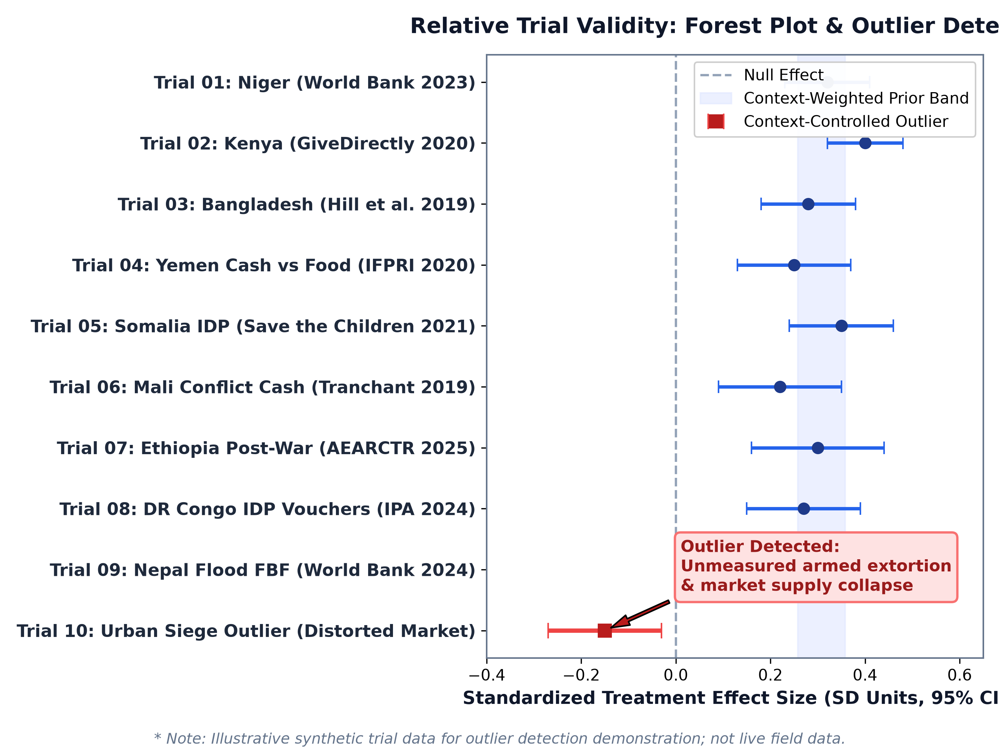
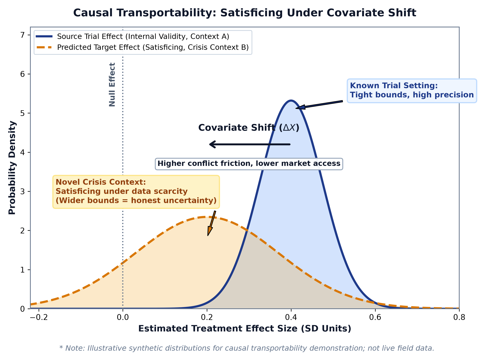

<!-- _class: lead -->
# The Humanitarian Planner's Dilemma
## Rapid, Evidence-Grounded Crisis Response Under Data Scarcity

<strong>Aaron Scherf</strong> &bull; Columbia University | Sustainable Development (SIPA) &bull; <em>3R Framework: Resilience, Response, and Recovery</em>

<!-- Note:
"When an extreme crisis strikes—a severe drought tipping into famine, or a flood in an active conflict zone—humanitarian agencies face an acute operational dilemma. Lives depend on designing an effective response in days or weeks. But traditional academic research is not packaged for rapid consumption: planners are confronted with thousands of dense papers of uncertain local relevance. Today, I'm presenting an open-source computational pipeline that bridges this divide."
-->

---

# The Reality of Crisis Response: Search Costs & Portfolio Decisions

* **Evidence Search & Consumption Costs:**
  * Thousands of evaluations exist (3ie, J-PAL, World Bank), but they are locked in fragmented repositories and 80-page PDFs.
  * Responders cannot consume, evaluate, or standardize them during an unfolding emergency.
* **The Portfolio Optimization Problem:**
  * Academic papers isolate single interventions for clean internal validity.
  * Responders face an **open canvas and fixed budget**—needing to determine the *optimal mix* of cash, food aid, vouchers, insurance, and logistics.
* **The Resilience Planning Parallel:**
  * Planners face severe data scarcity (no live field surveys).
  * Almost always planning for **unprecedented local shocks**—inherently requiring evidence borrowed and adapted from other contexts.

<!-- Note:
"Practitioners don't lack evidence—they face prohibitive search and synthesis costs. Furthermore, their fundamental challenge is portfolio choice under hard budget constraints. In an emergency, should you inject mobile cash, pre-position grain, or trigger parametric insurance? Our goal is to give them a tool to simulate those trade-offs."
-->

---

# State of the Art: The Limitations of Existing Frameworks

* **[3ie Evidence & Gap Maps](https://www.3ieimpact.org/evidence-hub):**
  * Excellent taxonomies, but static and manually curated.
  * Disconnected from live spatial data; does not extract reusable estimators.
* **[World Bank DIME / Microdata](https://microdata.worldbank.org/) & [HDX](https://data.humdata.org/):**
  * Rich passive data repositories lacking counterfactual simulation engines.
* **Academic Hierarchical Modeling:**
  * [Meager (2019)](https://pubs.aeaweb.org/doi/10.1257/app.20170299) & [Vivalt (2020)](https://academic.oup.com/jeea/article/18/6/2782/5819777): Prove high cross-study effect variance across microcredit and social programs.
  * [Pritchett & Sandefur (2015)](https://www.aeaweb.org/articles?id=10.1257/aer.p20151069): External trial estimates often yield higher error than local non-experimental data.
  * *Limitation:* Retrospective academic studies on clean survey microdata; inapplicable to rapid, live crisis response.

<!-- Note:
"We aren't starting from scratch—3ie, the World Bank, and econometricians like Rachael Meager and Eva Vivalt have laid crucial groundwork. But 3ie maps are static bibliographies; World Bank portals are passive data repositories; and academic Bayesian meta-analyses take years to run on clean survey microdata. None of them help a planner in Mogadishu simulate an intervention next week."
-->

---

# Foundational Architecture: Standardized, Reproducible Research (`reprokit`)

* **Standardizing Open Science & Data Science:**
  * Orchestrated via [`reprokit`](../../../projects/reprokit/README.md) (v0.4.0 released, open-source).
  * Independent verification regardless of technical background.
* **Three Project Archetypes:**
  * `study`: Empirical pipelines with automated hash verification.
  * `evidence`: Machine-readable evidence maps and manifests.
  * `library`: Reusable data fusion and analytics packages.
* **Built for Human and Agent Readability:**
  * Standardized metadata (`project.yaml`, `AGENTS.md`) allows autonomous LLM agents to parse and audit codebases at scale.
  * Dual-interface: accessible to humans, verifiable by agents.
* **Portability Across Contexts:** Hash-pinned inputs and CI on Linux/Windows enable rapid porting to new crises.

<!-- Note:
"Reproducibility cannot depend on a researcher's individual technical background or fragile personal scripts. We built reprokit to unify open science best practices, software standards, and data science into a standardized directory structure. Crucially, it is built for AI-assisted research: project directories are fully legible to humans and agents alike, meaning an LLM can parse and reproduce them at scale under strict behavioral rules."
-->

---

# The 2x2 System Architecture
## Integrating Context Ingestion, Evidence Synthesis, and Causal Transportability

<!-- Note:
"The core of this research agenda is a 2×2 engine. On one axis, we bridge context data with published literature. On the other, we bridge continuous discovery with rigorous quantitative extraction. These four blocks don't operate in a straight line; they feed each other iteratively to build an actionable evidence base that converges on our causal transportability model."
-->

---

# Component 1.1: Automated Literature Discovery & Synthesis

* **Overcoming Search Costs:**
  * Automated scrapers continuously harvest OpenAlex, academic APIs, and grey literature portals (ALNAP, ReliefWeb, World Bank OKR).
* **Snowball & Semantic Graph Expansion:**
  * Traces forward/backward citation networks around key crisis topics.
  * Extracts metadata, abstract embeddings, and author linkages.
* **Standalone Usable Deliverables:**
  * Not just an intermediate step: produces a **comprehensive, publishable literature review** and evidence synthesis on demand for any designated geography.
* **Current Status:**
  * Active Automated harvesting running; expanding from ad-hoc sampling to systematic corpus extraction.

<!-- Note:
"Component 1.1 solves the practitioner's search cost problem. Instead of spending months searching, our pipeline crawls academic APIs and institutional archives, tracing citation networks through snowball sampling. Importantly, the literature review generated here is itself an immediate, usable standalone product that practitioners can read and cite."
-->

---

# Component 1.2: Subnational Context Data Fusion & Analytics Library

* **Standalone Research Deliverables:**
  * The harmonized panel dataset and the processing pipeline are valuable standalone research assets.
* **The Open-Source Data Fusion Library:**
  * Automates multi-modal ingestion (satellite rasters, point events, price feeds).
  * Standardizes spatiotemporal boundaries (Admin-2 / district-month).
  * Automated cleaning, spatial joins, and missingness audits.
* **Core Technical Contribution:**
  * Transforms high-dimensional Earth observation rasters (CHIRPS precipitation, night lights) into structured, tabular context variables alongside conflict logs (ACLED/UCDP) and market feeds (WFP).
* **Proof of Concept:** Somalia and Sudan pipelines rebuilt with 100% hash matching on CI.

<!-- Note:
"Component 1.2 is our context data fusion layer. The resulting panel dataset and processing pipeline are standalone research assets. We are packaging this into an open-source data fusion library that automates ingestion, cleaning, and spatial matching. The core contribution is taking high-dimensional satellite rasters and converting them into structured, tabular context variables that sit right alongside conflict events and market prices."
-->

---

# Component 2.1: Quantifying Evidence Coverage via 3ie Taxonomies

* **Multi-Dimensional Evidence Matrices:**
  * Categorizes academic and institutional grey literature using 3ie’s standardized intervention (cash, vouchers, insurance, public works) and outcome taxonomies (consumption, nutrition, displacement).
* **Country-Specific Granularity:**
  * Generates distinct evidence heatmaps for any target country of interest (starting with Somalia and Sudan testbeds).
* **Diagnosing "Evidence Deserts":**
  * Dense green zones: Cash in peaceful agricultural settings.
  * Blank/red deserts: Parametric insurance, anticipatory cash, or social safety nets under active conflict.
* **Current Status:**
  * Active Proof-of-concept classification complete on initial paper sample; scaling across the corpus.

<!-- Note:
"In Component 2.1, we move from qualitative reading to quantitative mapping. By applying 3ie's taxonomy, we construct evidence heatmaps across interventions and outcomes for specific crisis geographies, such as Somalia and Sudan. This systematically flags 'evidence deserts'—for example, where parametric insurance has never been evaluated against displacement in conflict zones."
-->

---

# Component 2.2: Curating Whole Trial Repositories & The Geolocation Gate

* **Candidate Corpus: Whole Evaluation Databases:**
  * Curating trial data from complete public databases: **AEA Data and Code Repository**, **World Bank DIME / Microdata Catalog**, and **Harvard / J-PAL Dataverse**.
  * Initial test cases: Cash transfer evaluations in Niger (4,000 villages), Bangladesh flood response, and Horn of Africa safety nets.
* **The Geolocation Bottleneck (The Gate):**
  * **The Challenge:** To link an experimental trial with local satellite and conflict context, we require village or cluster GPS coordinates.
  * **The Hurdle:** Many public trial datasets mask GPS coordinates to protect participant privacy in fragile contexts.
* **Resolution Strategy:**
  * 1. Public spatial replication packages.
  * 2. Author outreach and institutional agreements.

<!-- Note:
"Component 2.2 builds our empirical trials repository. We aren't just downloading one-off studies; our candidate corpus encompasses complete evaluation databases like the AEA, World Bank DIME, and Harvard/J-PAL Dataverse. But here we encounter our primary empirical bottleneck: the Geolocation Gate. To anchor a trial to our satellite and conflict grids, we need coordinates, which are often masked for safety. Solving this unlocks the entire causal transportability agenda."
-->

---

# Convergence & Empirical Validation: Relative Trial Validity

* **The Feedback Loop Between 1.2 and 2.2:**
  * Unmasked trial sites merge with our subnational context panel (rainfall anomalies, market prices, local conflict intensity).
* **Relative Trial Validity Check:**
  * Instead of assessing a trial in a vacuum, we evaluate its treatment effect relative to similar trials across different contexts.
* **Automated Outlier Detection:**
  * *Example:* If an urban siege trial shows negative welfare effects while 9 rural cash trials show positive effects, the model flags an outlier.
  * *Interpretation:* Unmeasured market collapse or extortion distorted the expected causal mechanism.
* **Refining the Prior:** Outliers feed back into the 2×2 engine, flagging unmodeled structural variables.

<!-- Note:
"When context data merges with trial microdata, we achieve empirical convergence. We can conduct a relative validity check: comparing treatment effects across trials under varying contextual conditions. If a trial in an urban siege yields negative effects while other cash programs succeed, our pipeline flags it as a context-driven outlier, pointing directly to unmeasured market breakdown or armed extortion."
-->

---

# Causal Transportability Under Covariate Shift: Satisficing in Crises

* **The Baseline Challenge: Covariate Shift:**
  * External transportability fails even in peaceful settings: populations, market density, and baseline wealth differ across borders.
  * Interventions are held constant, but the background environment changes ($X_{source} \neq X_{target}$).
* **Satisficing Under Data Scarcity:**
  * In active conflict and disasters, perfect identification is impossible because field surveys cannot be conducted.
  * **The Goal is Satisficing:** Generating the best possible empirical estimates of potential impact with valid, honest confidence intervals.
* **Quantifying What Does NOT Apply:**
  * Measuring the degree to which past evidence does *not* translate, modeling effect variability from known trial dispersions.

<!-- Note:
"Causal transportability is difficult even between peaceful countries due to covariate shift. In crisis settings, where field surveys are impossible, we must satisfice. We aren't claiming to identify a perfect point estimate. Rather, we are measuring the degree to which prior evidence does NOT apply—yielding honest, empirically grounded confidence intervals that reflect the real friction of the new context."
-->

---

# Structural Breaks in Causal Linkages: When Mechanisms Collapse

* **Beyond Covariate Shift: The Structural Break:**
  * *In Peace:* Cash to farmers increases drought resilience, assuming open trade corridors, functional mobile networks, and non-predatory authorities.
  * *In Conflict:* Armed groups extort recipients, mobile networks are jammed, or trade routes are blockaded. Causal linkages collapse.
* **Structural Break as a Validity Check:**
  * An essential audit of whether the causal chain itself is intact before attempting covariate adjustment.
* **Modeling Breakdowns with Directed Acyclic Graphs (DAGs):**
  * Mapping nodes: Transfer &rarr; Liquidity &rarr; Market Purchase &rarr; Welfare.
  * Identifying friction nodes: Military blockades, inflation spikes, and extortion.
* **Operational Route-Arounds:** If the market link is broken (inelastic supply), planners know cash will fail and in-kind food distribution is required.

<!-- Note:
"Conflict doesn't just shift covariates; it causes structural breaks. In peace, giving a farmer cash helps them survive a drought. In war, if an armed group taxes the cash or blocks the market road, the causal mechanism itself collapses. By formally modeling these linkages with Directed Acyclic Graphs, we can run a structural validity check. If the model shows the market link is broken, it warns planners immediately: don't send cash into an inelastic blockade; send physical food or repair the supply corridor first."
-->

---

# The Methodological Toolkit: Estimating Impact in Novel Localities

* **A Modular Set of Complementary Tools:**
  * Not a single rigid equation, but a flexible toolkit tailored for different data environments.
* **Bayesian Hierarchical Modeling (e.g., [Meager 2019](https://pubs.aeaweb.org/doi/10.1257/app.20170299)):**
  * Priors from past trials, updated by observed context shifts (from fusion panel) to yield posterior distributions for the target site.
* **Synthetic Controls / Multi-Trial Weighting:**
  * Weighting historical trials as a synthetic donor pool based on spatial, climate, and institutional similarity.
* **Double Machine Learning (DML; Chernozhukov et al.):**
  * High-dimensional regularized estimation to control for complex spatiotemporal confounders.
* **Causal Neural Networks & Neural DAGs:**
  * Learning representations under structural graph constraints, modeling non-linear interactions across satellite rasters.

<!-- Note:
"We aren't attempting to force all these tools into a single equation. We are building a flexible methodological toolkit. Bayesian hierarchical models update priors with local context shifts; synthetic controls construct weighted donor pools from past trials; Double Machine Learning controls for high-dimensional spatial confounders; and modern Causal Neural Networks let us model non-linear interactions under structural DAG constraints. Together, they output a credible, probabilistic impact distribution."
-->

---

# Decision Support in Action: The Simulation Response Exercise

* **The Simulation Response Exercise:**
  * Runs the transport engine across candidate interventions for a target district under hard budget constraints ($5M, 3-week window in Baidoa).
  * Simulates predicted welfare gains, cost-effectiveness, and uncertainty bounds.
* **Overcoming Inelastic Supply Corridors:**
  * *Option A (Pure Cash):* Rapid delivery, but high risk of triggering hyper-local price inflation under armed blockade.
  * *Option B (Food Aid Convoys):* Immune to local grain inflation, but heavy logistical overhead.
  * *Option C (Layered Portfolio - Recommended):* Food convoys break supply inelasticity, allowing cash to restore family livelihoods.
* **Active Real-World Engagement:**
  * Collaborating with a foundation in Armenia to deploy this structured evidence mapping and decision simulation toolkit for emergency planning.

<!-- Note:
"This brings us to the operational deliverable: the Simulation Response Exercise. Instead of debating in a conference room, a disaster response agency can select their crisis district, enter their budget, and run simulations across intervention options. The model displays predicted treatment effects, error bars, and risk factors for each choice—including how to layer programs. This isn't theoretical: we are already actively collaborating with a foundation in Armenia to apply this evidence-mapping methodology to real-world planning."
-->

---

# Methodological Frontiers, Open Questions & Roadmap

* **Core Theoretical & Empirical Frontiers:**
  * **Intervention Combining & Layering:** Modeling positive complementarities when cash, food aid, and insurance are combined.
  * **Displacement & Mobility Dynamics:** Does emergency aid facilitate safe evacuation or cause entrapment under armed siege?
  * **Spatial Resolution Limits:** Resolving conflict events and mobility vectors below Admin-2 to match trial clusters.
  * **Proxy Surrogacy in Conflict:** When do satellite indicators (NDVI, night lights) fail as proxies for welfare?
* **Roadmap & Planned Milestones:**
  * **Nov 2026 (Now):** Case study replication, reprokit v0.4.0 live, SusDev Brownbag, and geolocation data audit.
  * **Spring 2027 (Evidence Scaling):** 2x2 matrix synthesis, OpenAlex corpus sweep, SusDev Seminar talk, and Working Paper 1.
  * **Summer 2027 (Transport Models):** Formal causal transportability framework (covariate shift & DAG structural breaks).
  * **Fall 2027 (Applied Case Test):** Simulation response exercise tested against real-world crisis scenario.

<!-- Note:
"We have significant frontiers ahead: modeling intervention layering, treating forced displacement endogenously, and resolving spatial data to match village trial clusters. Our roadmap moves deliberately from foundational case study replication now, to evidence scaling and our first working paper in Spring 2027, followed by formal causal transportability modeling in Summer 2027 and applied field testing in Fall 2027. Thank you, and I look forward to your feedback."
-->
