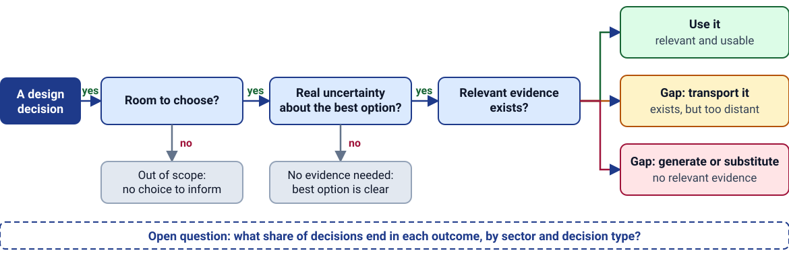
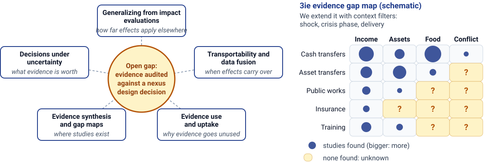
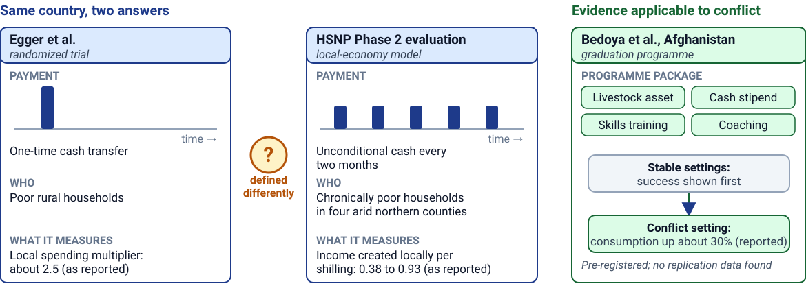
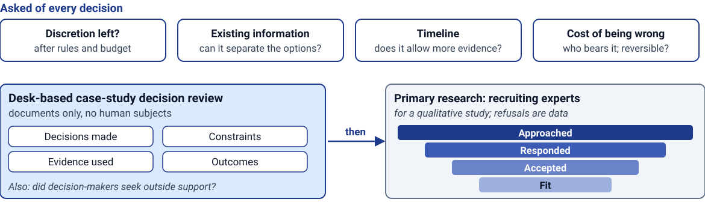
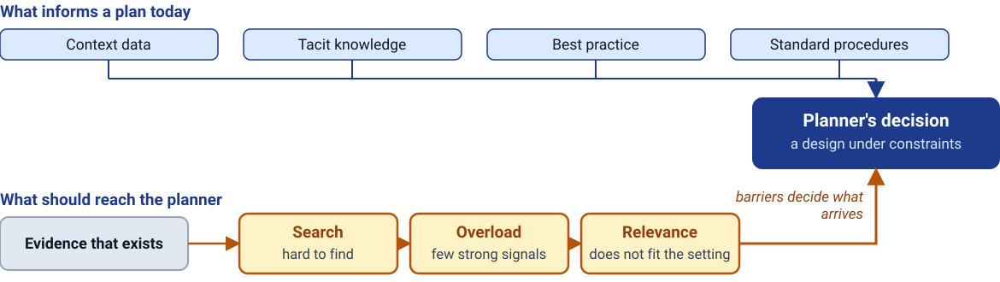
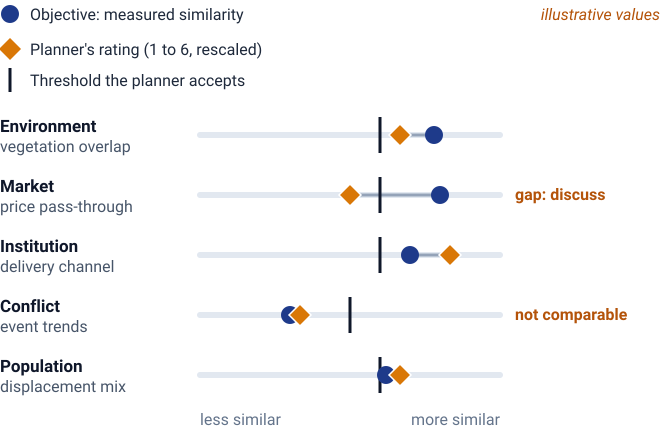
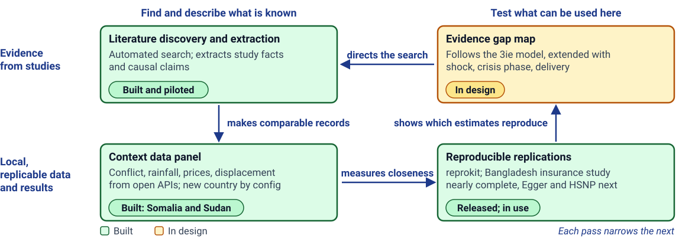
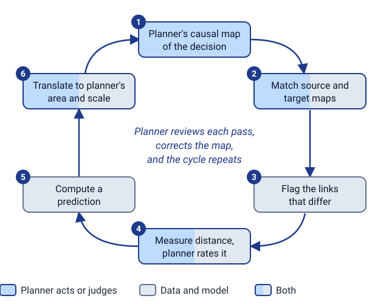
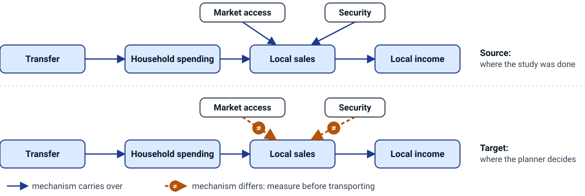
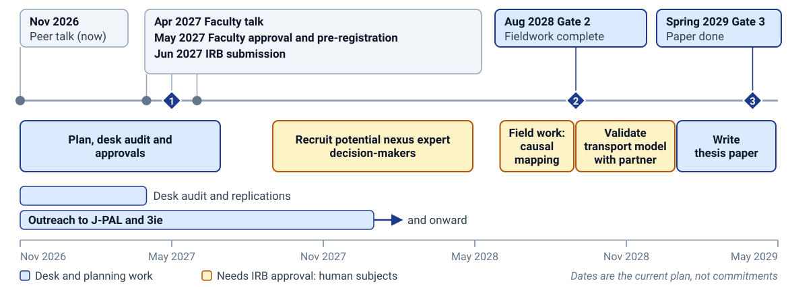

<!-- _class: lead -->
# Matching Evidence to Decisions in Prolonged Crises
## Can we say beforehand how far a finding travels, and for which decision?

**Aaron Scherf** &bull; Columbia University | Sustainable Development (SIPA)

**Example of the decision we study (hypothetical).** After repeated drought, should a programme extend short-term cash transfers or link households to a long-term safety net?

## Why these decisions matter: crises are large and last for years

* Fragile and conflict-affected settings hold a growing share of the world's extreme poor (World Bank, 2025 projection)
* About seven in ten refugees are in protracted situations (UNHCR, 2025)
* About 239 million people need humanitarian aid (OCHA, 2026)

<!-- VERIFY BEFORE FRIDAY: the three scale figures came from a web-search summary, not the primary pages. World Bank June 2025 report on fragile and conflict-affected situations (roughly 435 million, nearly 60 percent of the extreme poor by 2030, sensitive to the poverty line used); UNHCR Global Trends 2025 (about 70 percent of refugees in protracted exile); OCHA Global Humanitarian Overview 2026 (about 239 million in need). Put the verified figure and the poverty line on the slide, or keep the wording qualitative. -->

<!-- Note:
"Every one of those people is reached through a design choice that someone made. The box is one example of that kind of choice, invented for illustration, not a documented programme. This talk is about how the person making it chooses, and whether the research we have helps them." Do not say: most of the world's poor; the older two-thirds projection; that these figures show planners lack evidence. They show the stakes.
-->

---

# Who decides, what they decide, and why discretion matters

**Topic of study:** the **humanitarian&ndash;development nexus**, the established term for coordinating life-saving aid with longer-term development when shocks repeat or crises last for years.

* Evidence can only change choices that are open: in the example, extending cash or linking to a safety net is a real choice only if the rules and budget allow both
* So we **measure discretion** decision by decision instead of assuming it

<!-- Note:
The audience is economists and environmental scientists, not humanitarian specialists, so fix the vocabulary first. "Nexus" is the accepted term (humanitarian-development nexus, or humanitarian-development-peace nexus in OECD DAC usage); do not describe it as my wording. Actors for the visual: field planners (design and adaptation); headquarters and central research offices (policies that constrain field choices; research agendas); evidence funders (which new studies to fund); researchers (what to study); donors and governments (funding and rules). Research made with this audience in mind (the reprokit principle). Do not say that discretion is small or large in general; that is what the first research question measures.
-->

---

# Evidence is worth seeking only if it could change the choice

* **Value of information** comes from health economics: more evidence is worth getting only if it could change which option is chosen. We apply it to programme design
* Relevance has two parts: **distance** (will it hold here?) and **actionability** (can this planner implement it?)
* A real case: the Kenya HSNP Phase 2 business case weighed seven expansion options. The evidence supported all of them and did not separate them

<!-- Note:
Economists know this as the expected value of information (Claxton 1999; Fenwick et al. 2008, health technology assessment); Brown, Salisbury and Ball (2025) apply it to grant allocation. Hjort et al. (2021): mayors valued research, and a research session raised adoption of a policy. The full table, with the "constrained discretion" column, is in the appendix. Kenya HSNP was checked against the Business Case and Completion Review; the options weighting tables were not read; HSNP options differ in scale, speed and financing, not intervention type. The flow simplifies a continuum. Do not say that decisions fall neatly in cells.
-->

---

# Where this sits in the literature

* Nearest humanitarian work found: IDinsight (value of information for commissioning an evaluation), ALNAP (immediate-response decisions), Elrha (barriers). None audits existing evidence against a nexus design decision
* **Why start in crises:** the hard case has the least evidence and the most constraint, so a method that works here should carry to fields with more and closer evidence

<!-- Note:
Say the pattern aloud: development economics asks how far results travel; causal inference asks when they can; policy studies ask why they are not used; gap maps show where they exist; decision science asks what they are worth. This work puts the five together on a decision that matters. Papers behind each field: Vivalt 2020, Pritchett and Sandefur 2015, Allcott, Meager, Banerjee et al., Bold et al. (generalizing); Bareinboim and Pearl, Gechter, Montiel Olea et al. (transportability); Oliver et al. 2014, Hjort et al. 2021 (evidence use); Snilstveit et al. 2016 (gap maps); Claxton, Brown et al. 2025, Kwakkel, Haasnoot and Walker 2016 (decisions). Identifiers were matched to registries, not all read. The descriptions are my characterization, not a literature review. A footnote worth saying: the examples in this talk come from the best-documented sector, cash and livelihoods. Say "the nearest I found", never "no one has studied this". No figures from the evidence-use scans.
-->

---

# Two Kenyan cash studies disagree; one programme travelled to conflict

The Kenyan studies report different quantities, and why their results differ is not established. Both are on our replication list.

<!-- Note:
Numbers stay out of the main text; if the visual shows them, keep them as reported ranges. Egger multiplier about 2.5; HSNP regular-transfer local-economy evaluation 0.38 to 0.93 income per shilling; Bedoya consumption up 30 percent (all three checked against the full-text transcripts). Do not show 0.38 to 0.93 beside 2.5 without a conversion note: if the HSNP figure is the additional income beyond the transfer, the comparable total multiplier is about 1.38 to 1.93, which narrows the apparent gap; the LEWIE methods must be read to confirm the convention. Egger versus HSNP is a hypothesis-generating pair, not a documented transport failure: one is an import-adjusted expenditure multiplier, the other income per shilling in four northern counties, and the Completion Review does not attribute the gap to a contextual factor. Methods sections not yet read. Replication: Egger package public; HSNP microdata held locally; Bedoya registered (Social Science Registry 2665), no data. These are illustrations chosen for documentation, not a sample. Do not say: one result failed to transport; Bedoya is a transport success proven by method. About three minutes.
-->

---

# Evidence&ndash;decision mismatch for humanitarian&ndash;development planners

<b>The problem.</b> Evidence and research attention are non-market goods, so what gets studied can be misallocated while nexus planners still lack evidence they can use. The mismatch is one of relevance.

Discretion and value of evidence

How much room do nexus planners have to choose, and how useful do they find the evidence available to them?

Decision mapping

What informs their decisions today, and what keeps relevant evidence from reaching them: hard to find, too much of it, or not relevant to their setting?

Evidence transport

Which barriers to using existing evidence can be reduced, and how well can we predict an intervention's effect in a new setting?

Predictions set realistic targets, then are checked against outcomes.

&#9660;

Primary goal: better-designed interventionsChecking predictions is a means to this, not the goal itself

More efficient allocation of research funding

More targeted evidence generation by development organizations

An open-source toolkit that generalizes to other uses

<!-- Note:
This is the spine; everything after is one of the three questions, which the rest of the talk calls by these names. The market-failure framing is the contribution to research allocation: evidence-generation funders (3ie, J-PAL, foundations) allocate attention, and a measure of how unique a context is separates a real gap from an adaptable one. If asked: the evaluation of predictions is instrumental; selecting and designing better interventions is the main mechanism of impact.
-->
---

# Discretion and value of evidence: what we measure first

* In scope: headquarters versus field constraints; where evidence generation should be allocated

**Still open:** the taxonomy of decisions (immediate response, long-term planning, operational, design), and the headquarters/field relationship.

<!-- Note:
The valid result "no additional evidence would help" is a stop outcome, not a failure. Instruments are proposals. Do not say that we know the share of decisions in any cell.
-->

---

# Decision mapping: what informs decisions today

* The unit of study is the **assumptions** behind a decision, in causal maps, scenarios and log-frames (the logic tables programmes write), stated or not
* **Feeds evidence transport:** the causal chain, blockers and log-frame assumptions say which links a source study must be checked on; the planner reviews them at each staged deliverable
* Eliciting causal maps from practitioners is the established field of **systems mapping**, usually qualitative. Linking it to causal graphs for quantitative transport is the untested part

<!-- Note:
Tennant et al. (2021) reviews how DAGs are reported in health research; it is not a participatory method. Pointers from memory, unverified: causal loop diagrams, fuzzy cognitive maps, group model building.
-->

---

# Evidence transport: how far does a finding travel? What counts as comparable

* We predict an intervention's effect in a new setting from studies elsewhere, to set a realistic target, then check it against the measured outcome
* Source and target are compared along named dimensions: spatial, temporal, institutional, market, treatment version, population, interference
* **Comparable is a profile, not one score.** Both measures must clear the planner's thresholds, and a disagreement between them is flagged
* Idea for choosing cases: an insecure region may resemble an insecure region elsewhere more than the rest of its own country

The scale and the values are illustrative. More than one expert rating is ideal, subject to availability.

<!-- Note:
General argument: Pritchett and Sandefur (2015) find transport error larger than local bias in most of their cases. Transport theory, bounds (Gechter) and site selection (Montiel Olea et al.) exist. The definition of "comparable" is still under investigation; this is a working proposal. The source and target maps need shared variables, so the source study's own causal story is matched to the target map first (next slides).
-->
---

# The pipeline already under construction

* **`reprokit`** records hashes and rebuilds in continuous integration, so anyone can re-run a result
* Replication is fast when geodata are public, or when we replicate without them; slow only if locations must be requested privately
* A **proof of concept for a re-runnable, open-source pipeline**, validated in the dissertation on one applied case

<!-- Note:
Honest scale: the cells are separate assets today; the links are the plan, not a finished system (projects tracker: panel built and reproducing, reprokit v0.4.0 released, evidence map in brainstorming, transferability planned, data-fusion toolkit deferred). "Largely automated" holds for discovery, extraction and context data; screening and judgment remain. Replication speed is a design claim, not yet timed. Bangladesh: owner reports the replication is nearly complete in full (2026-11-13); no village coordinates, so only the satellite-linked step there is gated. Egger's public package exists, but the authors' workflow restricts sensitive village locations. Stage-2 extraction pilot: verify figures in its status doc before quoting; confirm whether it extracts causal claims specifically. Do not say integrated, deployed, validated, or fully automated.
-->

---

# The transport model: built with the decision-maker

**Step 5 returns one of four prediction types**

| Type | When |
|---|---|
| Point estimate with standard errors | Maps match, distance small |
| Bounds (Gechter) | Partial overlap |
| Ordinal category or sign | Only direction supported |
| "Insufficient evidence" or "distance too great" | No defensible transport: a result |

<!-- Note:
Bias question: "the process is fixed in a protocol before we start, and every change is logged" (appendix). Do not say that the model replaces the decision-maker's judgment, or that the feedback loop is bias-free. A cycle diagram is a candidate visual for this slide.
-->
---

# Which differences matter: selection diagrams

A **selection diagram** is a causal graph, with boxes for variables and arrows for cause and effect, plus a mark on each arrow that works differently in the source and the target setting.

* Marked arrows say which differences **must be measured**, and whether a way to carry the result over exists at all
* Here the graph comes from the planner's decision map, matched to the source study's causal story

<!-- Note:
Selection diagram = Bareinboim and Pearl's formalism: an ordinary cause-and-effect diagram where the arrows that work differently in the two places are marked. Limits (cannot create missing data, repair a missing outcome or make an impossible delivery possible) are in the appendix. Likely first technical question from peers.
-->

---

# Approaches to explore, and the context data behind them

| Group | Approach, in plain words | Where the expert enters |
|---|---|---|
| What can be carried over? | **Selection diagrams:** which causal links differ | The graph comes from the planner's map |
| How to combine evidence | **Hierarchical Bayesian models:** borrow strength across sites by estimating how much effects vary between them | Priors; which sites count as comparable |
| How to combine evidence | **Similarity-weighted borrowing:** weight studies by how close their setting is to the target | Which variables, and how close is close enough |
| What if it cannot? | **Partial-identification bounds:** report the range of effects consistent with what is known | The assumptions the bounds rest on |

* **Context data:** remote sensing (rainfall, vegetation indices from Landsat, MODIS and Sentinel-2, night lights) plus conflict events, prices, displacement, boundaries
* **Limits:** satellites describe environment and activity, not treatment or welfare; resolution must suit the unit; site coordinates decide what can be linked
* **Test:** the Egger versus HSNP pair. Do the approaches agree on whether a result carried from one setting to the other?

<!-- Note:
Design choices around the approaches, not methods: which settings count as comparable (e.g. insecure regions in different countries); which studies to replicate next (k-median site selection, Montiel Olea et al.); a trigger to re-audit when a shock changes the setting. "Synthetic-control-style" weighting borrows the weighting idea only; synthetic control proper builds a counterfactual for one treated unit from a panel. A satellite treatment-effect comparison for the Kenya cash trial already exists (Huang et al.). No approach has been shown to work in crisis settings. Do not say that remote sensing identifies treatment effects, or that any approach is validated.
-->

---

# Timeline: three gates on the thesis schedule

**What the gates are for:** each shows the work can deliver before the next, costlier step.

* **Gate 1, answerable?** An approved audit shows the question can be measured from documents
* **Gate 2, mappable?** Practitioners' causal maps are usable and useful to the planner
* **Gate 3, transportable?** A validated method, then a partner uses it

<!-- Note:
Progress beyond the pipeline slide: an initial novelty check of the three questions against the nearest prior art (a spot check), and full-text transcripts of the Kenyan papers for direct reading. Next replications: Egger and HSNP Phase 2, compared directly. Outreach to J-PAL and 3ie covers decisions and evidence gaps in crisis settings, and replication data access. Ethics caution: asking J-PAL or 3ie staff about their decision-making could count as human-subjects research, so check with the IRB before outreach beyond routine requests for public data and replication materials. Do not say that a partner has agreed, that the audit has begun, that dates are fixed, or that IRB approval is assured. Four case-level checks also apply before investing in any single case: is there a documented decision and a fit partner; would new evidence be worth it (value of information); can anything be inferred from existing studies; can the outcome be evaluated. Gates here are the thesis-level checkpoints; the case checks are in the appendix.
-->

---
<!-- _class: lead -->
# Appendix

---

# A1. What a selection diagram can and cannot do

* It tells you which differences you **must measure** and whether a **formula to carry the result over exists at all**
* It **cannot** create data that do not exist, repair a missing outcome, or make an impossible delivery possible
* The formalism is Bareinboim and Pearl's; the graph here comes from the planner's decision map, matched to the source study's causal story

<!-- Note:
The plain-language definition and the example graph are on the main selection-diagram slide.
-->
---

# A2. The full decision table

| Relevant evidence exists? | Discretion: **yes** | Discretion: **no** (fixed by rules, budget, mandate) |
|---|---|---|
| Yes: relevant and actionable | **Use it** | On the shelf |
| Yes, but too distant | **Gap: transport the evidence (evidence transport)** | Not a priority |
| Yes, but not actionable here | **Gap: redesign or adapt (decision mapping)** | Not a priority |
| None | **Gap: generate or substitute** | Ignore |

* Scope: decisions where the planner already has discretion and lacks relevant evidence; evidence loosening constraints is plausible but out of scope
* Other states: little demand beyond logistics; abundant evidence not used; evidence used well; planners make do; insufficient evidence either way

---

# A3. Comparability profile (illustration)

| Dimension | Objective measure | Subjective rating (1 to 6, illustrative) |
|---|---|---|
| Environment | Overlap of the vegetation-index distributions | Planner: forest health 4 |
| Market | Market-access or price-pass-through indicator | Planner: 3 |
| Institution | Delivery channel (NGO, public safety net, payment rail) | Planner: 5 |
| Conflict exposure | Event counts and trends | Planner: 2 |
| Population | Displacement status, composition | Planner: 4 |

* Thresholds per dimension are set with the planner; a gap between the two columns on a row is flagged for discussion
* Values here are placeholders, not data

---

# A4. Validation, gates and timeline

| Research question | Validated when |
|---|---|
| **Discretion and value of evidence** | A working paper on the knowledge audit is approved by faculty, and at least one fit partner agrees with the funnel documented |
| **Decision mapping** | Desk phase: documents suffice to model constraints, scenarios and log-frames. Partner phase: the partner finds the process and products useful (needs ethics approval) |
| **Evidence transport** | Partial: a methodology paper with empirical validation. Full: a partner uses the results. Follow-on: predictions turn out reasonably correct |

* **Dates (owner's plan, 2026-11-13):** faculty talk April 2027; faculty approval and pre-registration May 2027; IRB submission June 2027; recruitment fall 2027 to spring 2028; field work summer 2028; transport model validated with a partner fall 2028; thesis paper spring 2029
* **Case-level checks before investing in a case:** case and partner fit; is new evidence worth it; what can be inferred; can it be evaluated

---

# A5. Bias controls for the feedback rounds

Someone will ask how planner feedback, with variables not fixed in advance, avoids p-hacking. The top ideas:

1. **A written, registered protocol:** the steps (data discovery, map matching, comparability profile, modelling, planner review, repeat), a stopping rule, fixed dimensions and approaches, and a log of every round and variable tried
2. **The planner rates similarity before seeing the predicted effect;** changes made after seeing the estimate are flagged
3. **Report sensitivity:** the prediction under every reasonable specification tried
4. **Lock the prediction before the outcome** (pre-registered, time-stamped)

Further controls (a planner-free baseline; more than one expert where available) are for the protocol to settle.

---

# A6. Project maturity: built, planned, gated

| Component | Status |
|---|---|
| Context panel (Somalia, Sudan) | Built and reproducing; separate config per country |
| `reprokit` | Released (v0.4.0, evidence kind added) |
| Literature discovery and extraction | Built and piloted |
| Evidence map (3ie-style gap map) | In design; study catalogue first |
| Bangladesh insurance replication | Nearly complete in full (owner, 2026-11-13); village coordinates are the gate for the satellite-linked step |
| Transferability | Planned; no repository yet |
| Data-fusion toolkit | Deferred |

---

# A7. Claims we keep, soften or drop

| Claim | Treatment |
|---|---|
| "No one has audited evidence for programme design" | **Soften:** nearest prior art found |
| Egger versus HSNP as a transport failure | **Soften:** hypothesis-generating pair |
| A complete corpus of trials; universal impact ranges; a live simulator or dashboard | **Dropped** |
| Impact estimates in novel localities | **Soften** to a tiered claim |
| Participatory causal maps produce usable log-frames | **Proposal** |
| The compound-shocks panel supports transfer | **Narrowly:** context only |
| Evidence-use patterns across the field | **Qualitative only;** the scans were not systematic |

---

# A8. Positioning and dropped use cases

* **Prior art found:** Brown et al. 2025 and IDinsight (value of information for funding); ALNAP (immediate-response decisions); Elrha (barriers); Egger-style and Bedoya-style trials (transport and fragile-setting cases)
* **Dropped use cases:** anticipatory action and index insurance are examples of modality and timing questions only, not research strands of this agenda; operational logistics optimization is a separate adjacent agenda
* **Not a claim** about which intervention is best

<!-- Note:
Anticipatory-action evaluations (Bangladesh, Nepal) remain useful examples of evaluable timing if asked.
-->

---

# A9. Open items to validate in the next few weeks

| Item | Why | Next step |
|---|---|---|
| **Scale figures** (World Bank, UNHCR, OCHA) | Opening slide; found via a web-search summary | Gemini check against the primary reports; name the poverty line |
| **Egger versus HSNP definitions** | Egger's multiplier is GDP per unit transferred; HSNP's 0.38 to 0.93 may be *additional* income beyond the transfer (total about 1.38 to 1.93) | Read the HSNP local-economy methods; harmonize before any comparison |
| **Replication feasibility** | Egger's package is public but village locations are restricted; HSNP data held locally; Bedoya data not found | Confirm what each supports; ask authors only for what is needed |
| **Bedoya et al.** | Aspirational case; claims checked on the abstract and registration only | Full read; check what enabled success |
| **Stage-2 extraction** | The pipeline slide says it extracts causal claims; pilot figures not re-verified | Confirm against its status doc |
| **Literature map** (slide 4) | Row descriptions are my characterization | Read one paper per field |
| **Evidence-use scans** | The "mixed, sector-dependent" picture rests on about 31 sources I have not read | Read a sample before relying on it |
| **Nexus definition** | Mine, not sourced | Read the OECD DAC recommendation |
| **Ethics and outreach** | J-PAL contact could count as human-subjects research | Ask the IRB before anything beyond public-data requests |

Design questions (decision taxonomy, headquarters/field relationship, the definition of "comparable") are tracked separately.

---

# A10. Sources consulted (1 of 2): read in full or checked against the text

* **Programme documents:** FCDO, Kenya Hunger Safety Net Programme Phase 2 &mdash; Business Case and Completion Review
* **Egger, Haushofer, Miguel, Niehaus, Walker (2022).** General equilibrium effects of cash transfers: experimental evidence from Kenya. *Econometrica*
* **Bedoya, Coville, Haushofer, Isaqzadeh, Shapiro (2019).** No household left behind: Afghanistan Targeting the Ultra Poor impact evaluation. NBER WP 25981
* **Pritchett and Sandefur (2015).** Context matters for the size of impact: experiments in other settings (microcredit)
* **Hjort et al. (2021).** How research affects policy: Brazilian municipalities
* **Crost, Felter and Johnston (2014; 2016).** Aid, insurgent response and conflict, Philippines (community-driven development; conditional cash transfers)
* **Brown, Salisbury and Ball (2025).** Value of information applied to grant allocation
* **Groh et al. (2016); Tennant et al. (2021); Altmejd et al. (2019).** Checked against the transcripts for specific claims

Full-text transcripts are held locally (git-ignored); identifiers and DOIs are in the novelty-check notes.

---

# A11. Sources consulted (2 of 2): identifier-matched, secondhand or not yet read

* **Matched to a registry, not read:** Vivalt (2020); Allcott (site selection bias); Meager (Bayesian hierarchical analysis of microcredit); Banerjee et al. (2016, proof of concept to scalable policies); Oliver et al. (2014, barriers to evidence use); Snilstveit et al. (2016, evidence gap maps); Kwakkel, Haasnoot and Walker (2016, robust decision-making and adaptive pathways); Bareinboim and Pearl (2012, transportability)
* **Read by Gemini only:** Gechter (bounds); Montiel Olea et al. (site selection); Bongers et al. (cyclic causal models); DellaVigna, Pope and Vivalt (2019); Kastner et al. (2009) and White et al. (2020) on capture-recapture; Bold et al. (2018); IDinsight (2022); ALNAP, Campbell and Knox Clarke (2019); Elrha, Smith, Swithern and Harrison (2022)
* **Two non-systematic scans of evidence use** (about 31 sources) by Gemini: not read by me; no figures used
* **Scale figures** (World Bank 2025; UNHCR Global Trends 2025; OCHA GHO 2026): web summaries, **being verified**
* **Not read:** OECD DAC nexus recommendation; Claxton (1999); Fenwick et al. (2008)

Reference hygiene: identifiers come from registries (Crossref), not model recall.

---

# A12. Why it matters beyond this case

* **Development economics:** context-dependent external validity of causal treatment effects for interventions
* **Decision science:** value of information applied to programme-design decisions, with measured discretion
* **Causal inference:** transport methods tested prospectively, with pre-registered predictions, in a hard setting
* **Climate and environmental decision-making:** a decision-relevance test for adaptation methods under uncertainty
* **Research funding and synthesis:** separating real research gaps from gaps existing evidence can fill
* **Research infrastructure:** an open-source, reproducible pipeline others can re-run on a different decision
* **Humanitarian practice:** a map of what informs plans, and where central rules block use of evidence

Intended contributions, not results. Each depends on the corresponding question working.
