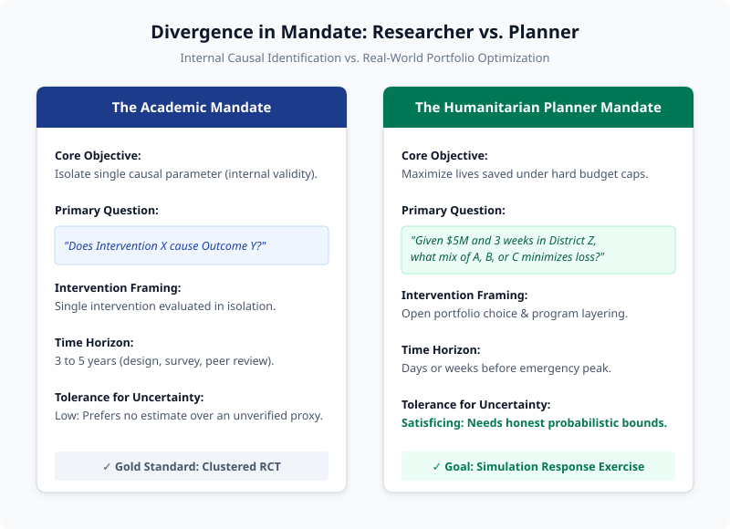
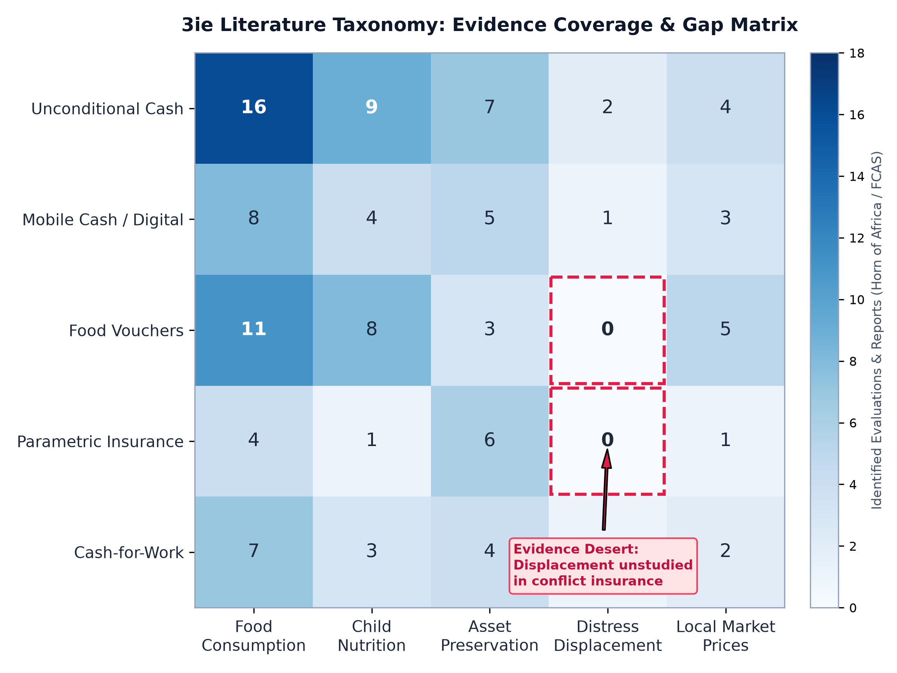
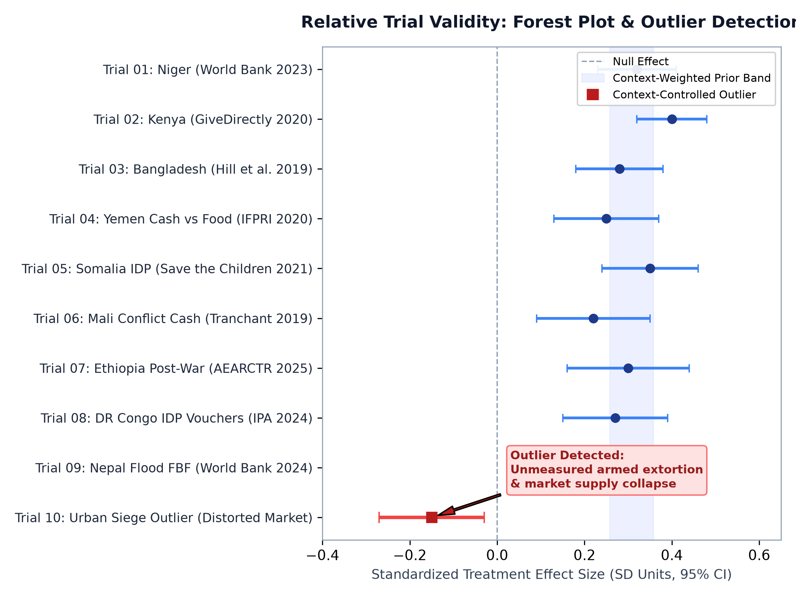
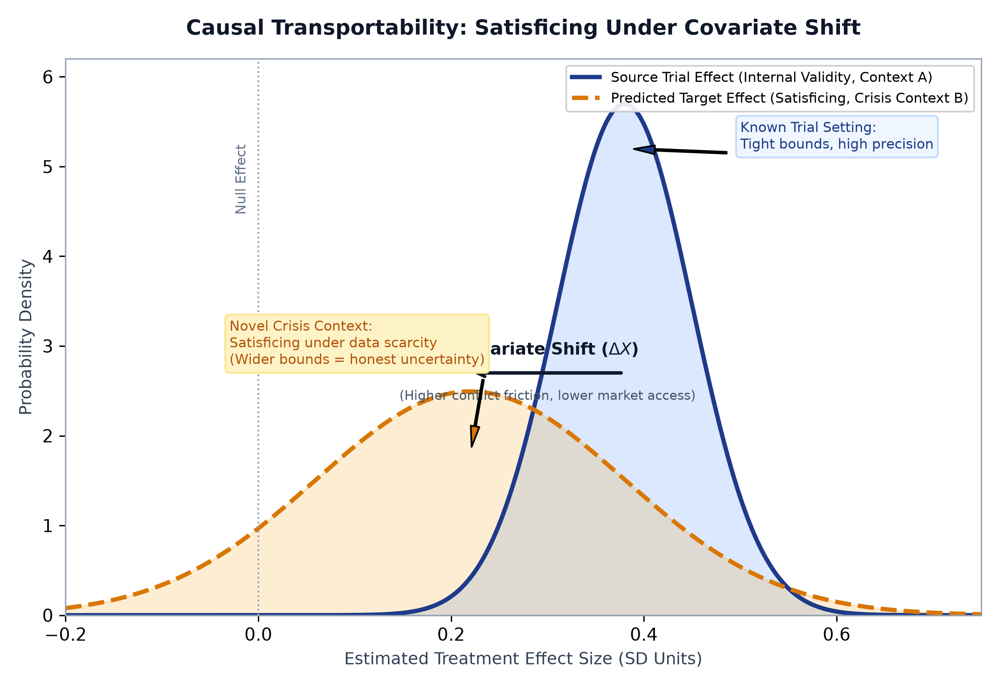

<!-- _class: lead -->
# The Humanitarian Planner's Dilemma
## Rapid, Evidence-Grounded Crisis Response Under Data Scarcity

**Aaron Scherf**  
Columbia University | Sustainable Development (SIPA)  
*3R Framework: Resilience, Response, and Recovery*

* **The Core Tension:** Extreme operational urgency vs. high evidence search costs and acute data scarcity.
* **The Goal:** An open-source, automated pipeline to ingest multi-modal data, quantify global evidence, and simulate intervention outcomes.

<!-- Note:
"When an extreme crisis strikes—a severe drought tipping into famine, or a flood in an active conflict zone—humanitarian agencies face an acute operational bind. Lives depend on designing an effective response in days or weeks. But traditional academic research is not packaged for consumption: planners are confronted with thousands of dense papers of uncertain local relevance. Today, I'm presenting an open-source computational pipeline that bridges this divide."
-->

---

# The Reality of Crisis Response: Search Costs & Portfolio Decisions

* **Evidence Search & Consumption Costs:**
  * Thousands of evaluations exist (3ie, J-PAL, World Bank), but they are locked in fragmented repositories and 80-page PDFs.
  * Planners cannot consume or standardize them in an emergency.
* **The Portfolio Optimization Problem:**
  * Academics isolate single interventions for internal validity.
  * Responders have an **open canvas and fixed budget**—needing to find the *optimal mix* of cash, food aid, insurance, and logistics.
* **The Resilience Planning Parallel:**
  * Planners face severe data scarcity (no field surveys).
  * Almost always planning for **unprecedented local events**—inherently requiring evidence borrowed from other contexts.

<!-- Note:
"Practitioners don't lack evidence—they face prohibitive search and synthesis costs. Furthermore, their fundamental challenge is portfolio choice under hard budget constraints. In an emergency, should you inject mobile cash, pre-position grain, or trigger parametric insurance? Our goal is to give them a tool to simulate those trade-offs."
-->

---

# State of the Art: The Limitations of Existing Frameworks

* **[3ie Evidence & Gap Maps](https://www.3ieimpact.org/evidence-hub):**
  * Excellent taxonomies, but static and manually curated.
  * Disconnected from live spatial data; does not extract reusable estimators.
* **[World Bank DIME / Microdata](https://microdata.worldbank.org/) & [HDX](https://data.humdata.org/):**
  * Passive data repositories lacking counterfactual simulation.
* **Academic Hierarchical Modeling:**
  * [Meager (2019)](https://pubs.aeaweb.org/doi/10.1257/app.20170299) & [Vivalt (2020)](https://academic.oup.com/jeea/article/18/6/2782/5819777): Prove high cross-study effect variance across microcredit and social programs.
  * [Pritchett & Sandefur (2015)](https://www.aeaweb.org/articles?id=10.1257/aer.p20151069): External trial estimates often yield higher error than local non-experimental data.
  * *Limitation:* Retrospective academic studies on clean survey microdata; inapplicable to rapid, live crisis response.

<!-- Note:
"We aren't starting from scratch—3ie, the World Bank, and econometricians like Rachael Meager and Eva Vivalt have laid crucial groundwork. But 3ie maps are static bibliographies; World Bank portals are passive data repositories; and academic Bayesian meta-analyses take years to run on clean survey microdata. None of them help a planner in Mogadishu simulate an intervention next week."
-->

---

# Foundational Architecture: Standardized, Reproducible Research (`reprokit`)

* **Standardizing Open Science & Data Science:**
  * Orchestrated via [`reprokit`](../../projects/reprokit/README.md) (v0.4.0 released, open-source).
  * Independent verification regardless of technical background.
* **Three Project Archetypes:**
  * `study`: Empirical pipelines with automated hash verification.
  * `evidence`: Machine-readable evidence maps and manifests.
  * `library`: Reusable data fusion and analytics packages.
* **Built for Human and Agent Readability:**
  * Metadata files (`project.yaml`, `AGENTS.md`) allow autonomous LLM agents to parse and audit codebases at scale.
  * Dual-interface: accessible to humans, verifiable by agents.
* **Portability Across Contexts:** Hash-pinned inputs and CI on Linux/Windows enable rapid porting to new crises.

<!-- Note:
"Reproducibility cannot depend on a researcher's individual technical background or fragile personal scripts. We built reprokit to unify open science best practices, software standards, and data science into a standardized directory structure. Crucially, it is built for AI-assisted research: project directories are fully legible to humans and agents alike, meaning an LLM can parse and reproduce them at scale under strict behavioral rules."
-->

---

# The 2×2 Evidence Engine: System Architecture

* **Dimension 1: Content Type**
  * *Context Data:* Multi-modal physical, conflict, and market feeds.
  * *Evidence Data:* Published academic papers and institutional evaluations.
* **Dimension 2: Methodological Mode**
  * *Discovery:* Continuous automated harvesting.
  * *Quantification:* Standardized taxonomies and microdata extraction.
* **The Four Quadrants:**
  * **1.1 Literature Search & Synthesis:** OpenAlex & web scraping.
  * **1.2 Context Data Fusion Panel:** Multi-modal subnational grids.
  * **2.1 3ie Evidence Taxonomy:** Quantifying coverage & gaps.
  * **2.2 Reproducible Trials Repository:** Open RCTs & estimators.

<!-- Note:
"The core of this research agenda is a 2×2 engine. On one axis, we bridge context data with published literature. On the other, we bridge discovery with rigorous quantification. These four blocks don't operate in a straight line; they feed each other iteratively to build an actionable evidence base."
-->

---

# Component 1.1: Automated Literature Discovery & Synthesis

* **Overcoming Search Costs:**
  * Automated scrapers continuously harvest OpenAlex, academic APIs, and grey literature portals (ALNAP, ReliefWeb, World Bank).
* **Snowball & Semantic Graph Expansion:**
  * Traces forward/backward citation networks around key crisis topics.
  * Extracts metadata, abstract embeddings, and author linkages.
* **Standalone Usable Deliverables:**
  * Not just an intermediate step: produces a **comprehensive, publishable literature review** and evidence synthesis on demand for any designated geography.
* **Current Status:**
  * Initialized Active harvesting; expanding from ad-hoc sampling to systematic corpus extraction.

<!-- Note:
"Component 1.1 solves the practitioner's search cost problem. Instead of spending months searching, our pipeline crawls academic APIs and institutional archives, tracing citation networks through snowball sampling. Importantly, the literature review generated here is itself an immediate, usable standalone product that practitioners can read and cite."
-->

---

# Component 1.2: Subnational Context Data Fusion & Analytics Library

* **Standalone Research Deliverables:**
  * The harmonized panel dataset and the data processing pipeline are standalone research assets.
* **The Open-Source Data Fusion Library:**
  * Automates multi-modal ingestion (satellite rasters, point events, price feeds).
  * Standardizes spatiotemporal boundaries (Admin-2 / district-month).
  * Automated cleaning, spatial matching, and missingness audits.
* **Core Technical Contribution:**
  * Transforms high-dimensional Earth observation rasters (CHIRPS precipitation, night lights) into structured, tabular context variables alongside conflict logs (ACLED/UCDP) and market feeds (WFP).
* **Proof of Concept:** Somalia and Sudan pipelines rebuilt with 100% hash matching on CI.

<!-- Note:
"Component 1.2 is our context data fusion layer. The resulting panel dataset and processing pipeline are standalone research assets. We are packaging this into an open-source data fusion library that automates ingestion, cleaning, and spatial matching. The core contribution is taking high-dimensional satellite rasters and converting them into structured, tabular context variables that sit right alongside conflict events and market prices."
-->

---

# Component 2.1: Quantifying Evidence Coverage via 3ie Taxonomies

* **Multi-Dimensional Evidence Matrices:**
  * Categorizes academic and institutional grey literature using 3ie’s standardized intervention (cash, vouchers, insurance, public works) and outcome taxonomies (consumption, nutrition, displacement).
* **Country-Specific Granularity:**
  * Generates distinct evidence heatmaps for any target country of interest (starting with Somalia and Sudan testbeds).
* **Diagnosing "Evidence Deserts":**
  * Dense green zones: Cash in peaceful agricultural settings.
  * Blank/red deserts: Parametric insurance, anticipatory cash, or social safety nets under active conflict.
* **Current Status:**
  * Yellow Proof-of-concept classification complete on initial paper sample; scaling across the corpus.

<!-- Note:
"In Component 2.1, we structure both academic literature and grey literature using the 3ie taxonomy. We construct country-specific evidence matrices—starting with Somalia and Sudan. Rather than reading dozens of disjointed reports, planners can view an evidence heatmap that immediately shows where interventions have strong empirical backing and where severe evidence deserts exist."
-->

---

# Component 2.2: Curating Whole Trial Repositories & The Geolocation Gate

* **Mining Whole Evaluation Repositories:**
  * Drawing directly from full database corpuses:
    * [AEA Data & Code](https://www.openicpsr.org/openicpsr/) (e.g., Niger cash/conflict rollout across 4,000 villages).
    * [World Bank Microdata](https://microdata.worldbank.org/) / DIME (e.g., Bangladesh flood cash).
    * [Harvard Dataverse](https://dataverse.harvard.edu/) & [J-PAL Dataverse](https://dataverse.harvard.edu/dataverse/jpal) (hundreds of open evaluation packages).
* **Extracting Estimators:**
  * Curating studies with open microdata and causally valid treatment estimators.
* **The Decisive Geolocation Gate:**
  * GPS coordinates are often masked in conflict zones for participant safety.
  * *Core Challenge:* Obtaining unmasked village-level coordinates to link experimental treatment effects to satellite context grids.

<!-- Note:
"Component 2.2 taps into the major trial databases—the AEA repository, World Bank Microdata, Harvard Dataverse, and J-PAL Dataverse. We curate studies with open microdata and clean treatment estimators. But our primary bottleneck is precise geolocation: authors frequently mask GPS coordinates in conflict areas for safety. Resolving this join—ethically and securely—is the critical bridge to spatial context."
-->

---

# The Evidence Cycle: Iterative Feedback & Relative Trial Validity

* **Reinforcing Iterative Loops:**
  * *Taxonomy $\leftrightarrow$ Search:* 2.1 gaps direct 1.1 targeted literature sweeps.
  * *Trials $\leftrightarrow$ Fusion:* 2.2 trials inject context variables into 1.2; 1.2 fusion panels anchor 2.2 trial coordinates.
* **Asymptotic Convergence:**
  * Continuously expanding until evidence coverage for a target domain is as complete and searchable as possible.
* **Context-Aware Relative Validity Checks:**
  * Evaluating multiple trials of the same intervention across comparable context grids reveals relative validity.
  * If 9 trials show positive effects but 1 is an extreme outlier under the same context, it exposes a study flaw or unmeasured confounder.
* **Calibrating Priors:** Similarity weighting across related trials establishes empirical variance spreads for Bayesian priors.

<!-- Note:
"These four components form an iterative cycle. Taxonomy gaps drive new searches; trials add new context features; and the fusion panel anchors trial coordinates. Over time, this converges toward an asymptotically complete knowledge corpus. Even more exciting: by controlling for spatial context, we can evaluate the relative validity of independent RCTs. If ten trials study cash transfers and one is a massive outlier under the same context, our model flags it, helping us calibrate realistic uncertainty bounds."
-->

---

# Causal Transportability in Practice: Satisficing Under Covariate Shift

* **The External Validity Dilemma:**
  * Causal transportability is notoriously difficult even across peaceful settings ([Pritchett & Sandefur 2015](https://www.aeaweb.org/articles?id=10.1257/aer.p20151069); [Vivalt 2020](https://academic.oup.com/jeea/article/18/6/2782/5819777)).
  * In crises, where primary data collection is impossible, waiting for perfect evidence is fatal.
* **Satisficing Under Data Scarcity:**
  * Generating the best, most reliable impact estimates possible with empirically grounded confidence bounds.
* **The Standard Covariate Shift Problem:**
  * Holding the intervention functionally constant (e.g., standard cash transfer).
  * Context distributions shift (climate stress, market density, baseline poverty).
* **Measuring Non-Applicability:**
  * Estimating the degree to which existing evidence does *not* apply in a new setting by modeling impact variability across known environments.

<!-- Note:
"Let's be candid about econometrics: external validity is notoriously hard even in peaceful settings. When we move into disasters and armed conflict, pure causal identification becomes harder still. But because primary data collection is impossible, doing nothing is not an option. We are satisficing: using the variability across known trials to measure the degree to which evidence does NOT apply, giving planners honest, context-adjusted impact estimates with realistic confidence intervals."
-->

---

# Beyond Covariate Shift: Structural Breaks in Crisis Environments

* **The Failure of Unstated Assumptions:**
  * *In Peace:* Cash to farmers increases drought resilience, assuming open trade corridors, functional mobile networks, and non-predatory authorities.
  * *In Conflict:* Armed groups extort recipients, mobile networks are jammed, or trade routes are blockaded. Causal linkages collapse.
* **Structural Break as a Validity Check:**
  * An essential audit of whether the causal chain itself is intact before attempting covariate adjustment.
* **Modeling Breakdowns with Directed Acyclic Graphs (DAGs):**
  * Mapping nodes: $Transfer \rightarrow Liquidity \rightarrow Market \; Purchase \rightarrow Welfare$.
  * Identifying friction nodes: Military blockades, inflation spikes, and extortion.
* **Operational Route-Arounds:** If the market link is broken (inelastic supply), planners know cash will fail and in-kind food distribution is required.

<!-- Note:
"Conflict doesn't just shift covariates; it causes structural breaks. In peace, giving a farmer cash helps them survive a drought. In war, if an armed group taxes the cash or blocks the market road, the causal mechanism itself collapses. By formally modeling these linkages with Directed Acyclic Graphs, we can run a structural validity check. If the model shows the market link is broken, it warns planners immediately: don't send cash into an inelastic blockade; send physical food or repair the supply corridor first."
-->

---

# The Methodological Toolkit: Estimating Impact in Novel Localities

* **A Modular Set of Proposed Tools (Not a Single Estimator):**
* **Bayesian Hierarchical Modeling (e.g., [Meager 2019](https://pubs.aeaweb.org/doi/10.1257/app.20170299)):**
  * Priors from past trials, updated by observed context shifts (from fusion panel) to yield posterior distributions for the target site.
* **Synthetic Controls / Multi-Trial Weighting:**
  * Weighting historical trials as a synthetic donor pool based on spatial and institutional similarity.
* **Double Machine Learning (DML; Chernozhukov et al.):**
  * High-dimensional regularized estimation to control for complex spatiotemporal confounders.
* **Causal Neural Networks & Neural DAGs:**
  * Using causal deep learning (e.g., Dragonnet, Causal VAEs, Neural SEMs) to learn representations under DAG constraints, modeling non-linear interactions across satellite rasters.

<!-- Note:
"We aren't attempting to force all these tools into a single equation. We are building a flexible methodological toolkit. Bayesian hierarchical models update priors with local context shifts; synthetic controls construct weighted donor pools from past trials; Double Machine Learning controls for high-dimensional spatial confounders; and modern Causal Neural Networks let us model non-linear interactions under structural DAG constraints. Together, they output a credible, probabilistic impact distribution."
-->

---

# Decision Support in Action: The Simulation Response Exercise

* **The Simulation Response Exercise:**
  * Running the transport engine across multiple candidate interventions for the same crisis geography under a fixed budget:
    * *Option A (Unconditional Cash):* High expected impact, but wide variance due to volatile local market prices.
    * *Option B (In-Kind Food Aid):* Lower logistical efficiency, but immune to market supply blockades.
    * *Option C (Parametric Index Payouts):* Rapid execution, but high basis risk.
* **Comparing & Layering Interventions:**
  * Modeling complementarities: evaluating whether layering cash with crop insurance or supply subsidies maximizes lives saved under budget caps.
* **Active Case Engagement:**
  * Ongoing practical collaboration with a foundation in Armenia to supply a structured evidence map and decision-support synthesis.

<!-- Note:
"This brings us to the operational deliverable: the Simulation Response Exercise. Instead of debating in a conference room, a disaster response agency can select their crisis district, enter their budget, and run simulations across intervention options. The model displays predicted treatment effects, error bars, and risk factors for each choice—including how to layer programs. This isn't theoretical: we are already actively collaborating with a foundation in Armenia to apply this evidence-mapping methodology to real-world planning."
-->

---

# Methodological Frontiers, Open Questions & Roadmap

* **Core Open Questions:**
  * *Intervention Combining & Layering:* How do we model complementarities across interventions in a novel context?
  * *Displacement & Migration Dynamics:* Does assistance facilitate safe evacuation or cause entrapment? Is displacement an outcome or a context filter?
  * *Spatial Resolution Limits:* Resolving conflict and displacement tracking below Admin-2 (district) to match village trial clusters.
  * *Proxy Surrogacy in Conflict:* When do satellite proxies (NDVI, night lights) fail statistical surrogacy for human welfare?
* **Ideal Testbeds:** Cash transfers and index insurance in drought-induced famine settings (Somalia and Sudan testbeds).
* **Immediate Roadmap:** Finalize village GPS linkages $\rightarrow$ Scale 3ie taxonomy classification $\rightarrow$ Complete transport proof of concept $\rightarrow$ Working paper for spring presentation.

<!-- Note:
"We have significant frontiers ahead. How do we model the layering of multiple interventions? How do we treat forced displacement? And how finely can we resolve conflict data below the district level? Our immediate roadmap focuses on testing village data linkages, scaling the 3ie taxonomy, and advancing our work in Armenia and the Horn of Africa, culminating in our working paper this spring. Thank you, and I look forward to your feedback."
-->
